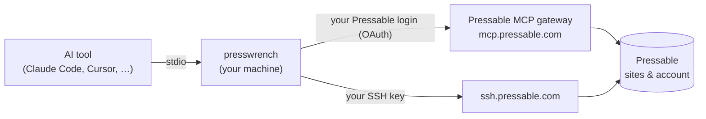

<div align="center">

# PressWrench

**Give your AI coding tool hands-on access to your Pressable WordPress sites — as you, with exactly your Pressable permissions.**

[](https://github.com/februality/presswrench/actions/workflows/ci.yml)
[](https://github.com/februality/presswrench/releases)
[](go.mod)
[](LICENSE)

[Quick start](#quick-start) · [How it compares](#how-it-compares) · [Tools](#tools) · [For teams](#for-teams) · [Safety](#safety) · [CLI](#cli)

</div>

PressWrench is a [Model Context Protocol](https://modelcontextprotocol.io) server for [Pressable](https://pressable.com). It works with Claude Code, Claude Desktop, Cursor, Windsurf, VS Code and Codex CLI, and combines two things no other option gives you together:

- **Every Pressable platform operation you're allowed to perform** — about 200: sites, staging and clones, domains, DNS, SSL, backups and restores, plugins and themes, PHP and WordPress versions, caching, logs, metrics, collaborators. These run through Pressable's own MCP gateway, so Pressable enforces your access and records every action in its activity log.
- **Real shell, WP-CLI and file access over SSH** — complete stdout, stderr and exit codes, returned synchronously, plus reading and writing files. This is the part Pressable's hosted MCP doesn't offer.

It ships as one static binary with a setup wizard. Developers sign in with their own Pressable login in the browser; nobody shares an owner API key.

> [!NOTE]
> PressWrench is an independent, community-built project. It is not affiliated with, endorsed by, or sponsored by Pressable or Automattic. "Pressable" is a trademark of its owner and is used here only to describe the service this tool works with.

> [!IMPORTANT]
> **Early release (v0.x).** It relies on Pressable's hosted MCP gateway, which Pressable runs as a public beta. Please [open an issue](https://github.com/februality/presswrench/issues) if something doesn't work with your account.

---

## Quick start

**macOS / Linux**

```bash
curl -fsSL https://raw.githubusercontent.com/februality/presswrench/main/install.sh | sh
```

**Windows (PowerShell)**

```powershell
irm https://raw.githubusercontent.com/februality/presswrench/main/install.ps1 | iex
```

**Or let your AI tool set it up**, including several Pressable accounts: see [Setting up through an AI agent](#setting-up-through-an-ai-agent).

The installer downloads the release for your platform, verifies its SHA-256 checksum and starts the setup wizard:

1. **Sign in.** A browser tab opens on my.pressable.com; approve access as yourself. The session is stored in your OS keychain. No local browser? Use `presswrench setup --manual-login` and paste back the URL you land on.
2. **Add your SSH key.** The wizard creates an Ed25519 key at `~/.ssh/presswrench` and copies the public key to your clipboard. Add it in **MyPressable → Profile → Settings → SSH Keys** with the name `presswrench`, and the wizard tests SSH against your sites. Pressable has no API for adding keys, so this is the one manual step. Skip it with `--skip-ssh` if you only want platform operations.
3. **Choose read-only or full access** (see [Safety](#safety)).
4. **Pick your AI tools.** Detected ones are pre-selected.
5. **Restart your AI tool**, then run `presswrench doctor` to check everything.

`presswrench setup` is safe to re-run at any time.

### Setting up through an AI agent

An agent can't answer the wizard's prompts, so it uses the non-interactive commands instead. You still approve each sign-in in your browser and add each SSH key in MyPressable. Paste this into Claude Code, Codex or any agent with a terminal:

> Set up PressWrench for me by following the "Setting up through an AI agent" steps at https://github.com/februality/presswrench#setting-up-through-an-ai-agent. Ask me which Pressable accounts to set up.

**Steps for the agent:**

1. **Ask the user** which Pressable accounts to set up. Give each extra account a short name (lowercase letters, digits, hyphens); a single account can use the default with no name. Also ask whether they want read-only or full access ([Safety](#safety)), and which AI tools to configure: `claude-code`, `claude-desktop`, `cursor`, `windsurf`, `vscode`, `codex`.
2. **Install without the wizard:**
   ```bash
   curl -fsSL https://raw.githubusercontent.com/februality/presswrench/main/install.sh | PRESSWRENCH_NO_WIZARD=1 sh
   ```
   On Windows: `$env:PRESSWRENCH_NO_WIZARD=1; irm https://raw.githubusercontent.com/februality/presswrench/main/install.ps1 | iex`. Use the path printed after `Installed:` for the commands below. It may be `~/.local/bin/presswrench`, which isn't always on `PATH`.
3. **For each account, one at a time:**
   1. Ask the user to sign in at my.pressable.com in their default browser **as that account**, signing out of the previous one first.
   2. Run `presswrench login --account <name>` (no `--account` for the default). It opens the browser and waits up to 5 minutes for the user to approve, so use a long command timeout or run it in the background. In a sandboxed agent, it may need permission to run outside the sandbox to open the browser, listen on 127.0.0.1 and use the OS keychain.
   3. Check the `◇ Signed in as <email>` line. If that email was already used for another account, the browser was signed in as the wrong user. Run `presswrench logout --account <name>`, have the user switch users, and sign in again.
   4. Run `presswrench setup --account <name> --unattended --client <id> --client <id>`, adding `--read-only` if chosen. It creates the SSH key and configures the AI tools without prompting.
   5. Give the user the printed public key. Ask them to add it in **MyPressable → Profile → Settings → SSH Keys**, signed in as that account, under the name `presswrench-<name>` (`presswrench` for the default account).
4. **Run `presswrench doctor`.** It checks every account, including SSH. Pressable can take a minute to create SSH logins after a key is added, so if SSH fails, wait and run it again.
5. **Tell the user to restart their AI tools** to load the new servers.

## What it looks like

Talk to your AI tool as usual. The prompts below are illustrative.

> **You:** Which of my sites are still on PHP 8.1, and do any of them have plugins with known vulnerabilities?
>
> **Agent:** *`pressable_execute` → `search_sites`, then `get_site_plugin_security_alerts` per site.* Three sites are on 8.1. `client-a` runs Elementor 3.18, which has a published vulnerability fixed in 3.18.2 …

> **You:** On example.com, find what's filling the PHP error log and fix it.
>
> **Agent:** *`pressable_execute` → `get_site_php_logs`, then `pressable_sftp_read` the offending file, `pressable_sftp_write` the fix, and `pressable_wp_cli` to confirm.* …

> **You:** Clone shop.example.com to a staging site in the same datacenter and update its URLs.
>
> **Agent:** *`pressable_execute` → `clone_site`, then `pressable_wp_cli` → `search-replace` on the clone.* …

> **You:** Add jane@agency.com to all live sites with WordPress and SFTP access.
>
> **Agent:** *`pressable_execute` → `bulk_add_collaborators_to_sites`. Pressable checks that you hold `manage_collaborators` on each site.* …

## How it compares

Comparison as of October 2026.

| | **PressWrench** | **Pressable's official MCP** | **API-key MCP servers** (community) | **Plain SSH** from the agent's terminal |
|---|---|---|---|---|
| Install | One-line installer + wizard | Nothing to install (hosted) | Clone, build, configure | Nothing |
| Sign-in | Your own Pressable login (browser) | Your own Pressable login (browser) | Account owner's API key | Your SSH key |
| **Scoped to each developer's permissions** | ✅ enforced by Pressable | ✅ enforced by Pressable | ❌ full account rights | Partial — only sites with SFTP access |
| Platform operations | ~200 (via Pressable's gateway) | ~200 | Varies (hand-written subset) | ❌ |
| WP-CLI | ✅ synchronous, full output | ⚠️ asynchronous, output trimmed to 500 characters | ⚠️ asynchronous, via the API | ✅ full output |
| Shell commands | ✅ full stdout, stderr, exit code | ❌ output not returned | ⚠️ asynchronous, via the API | ✅ |
| Read and write files | ✅ atomic writes | ❌ | Usually ❌ | ✅ via `scp` / `sftp` |
| SSH credentials | Personal SSH key | — | Often resets the site's SFTP password | Personal SSH key |
| Address sites by name or domain | ✅ | ✅ | Varies | ❌ needs each site's SFTP username |
| Local read-only mode and blocked operations | ✅ | ❌ | ❌ | ❌ |
| Several Pressable logins | ✅ named accounts | One per connector | One key per config | Manual |
| Works in claude.ai on web and mobile | ❌ runs locally | ✅ | ❌ | ❌ |
| Who runs it | You (open source) | Pressable (public beta) | You | — |

### When to use which

- **A team of developers who need to work inside sites — shell, WP-CLI, files — each limited to what Pressable lets them do:** PressWrench.
- **Quick platform tasks from claude.ai or your phone, with nothing to install:** Pressable's official MCP.
- **A single account owner who is happy to put the owner API key in a config file:** an API-key server works, but every user of it acts with full account rights.
- **The occasional manual fix:** plain SSH is enough if you already know the site's SFTP username.

### Trade-offs to know about

- **Platform operations depend on Pressable's hosted gateway.** PressWrench forwards them to `mcp.pressable.com`, because that is the only Pressable API that accepts a developer's own login (Pressable's REST API only accepts owner-created API keys). If the gateway is unavailable, platform operations fail; SSH, WP-CLI and file tools keep working.
- **Platform calls take an extra step.** The AI looks an operation up before running it (discover → describe → execute). That costs a round trip or two, but new Pressable operations appear without a PressWrench update.
- **It runs on your machine**, so it isn't available in claude.ai on the web or mobile.
- **Each developer adds their SSH key once** in MyPressable.

## Tools

| Tool | What it does |
|---|---|
| `pressable_discover` | List the Pressable operations available to you (filter with `query`) |
| `pressable_describe` | Show an operation's parameters and whether Pressable marks it read-only or destructive |
| `pressable_execute` | Run an operation as you, subject to Pressable's permissions and your local policy |
| `pressable_ssh_exec` | Run a shell command on a site; returns full stdout, stderr and exit code |
| `pressable_wp_cli` | Run a WP-CLI command on a site; the leading `wp` is optional |
| `pressable_sftp_read` | Read a text file |
| `pressable_sftp_write` | Write a text file atomically (replaces the whole file; parent folders on request) |
| `pressable_sftp_list` | List a directory |
| `pressable_ssh_status` | Show your local SSH key; with `site`, find and test your SSH login there |

Site tools accept a site name, domain or numeric ID — exact matches only, so a typo returns a "did you mean" list instead of acting on the wrong site. Paths can be relative to the web root (`wp-content/…`) or absolute (`/srv/htdocs/…`).

## For teams

PressWrench never widens anyone's access. Each developer's AI tool can do what that developer can do in MyPressable, and nothing else.

**Account owner or admin:** there are no API keys to create or share. Make each developer a collaborator on the right sites with the right roles:

| The developer needs to… | Pressable roles |
|---|---|
| Use shell, WP-CLI and file tools | `sftp_access` — Pressable only creates their SSH login on these sites |
| Manage plugins, themes, WordPress users and cron | `manage_wordpress` |
| Run backups and restores, manage DNS, cache and performance | `manage_backups_restores`, `manage_dns`, `manage_performance` |
| Change PHP or WordPress versions | `update_site_php_version`, `update_site_wordpress_version` |
| Delete sites | `delete_site` — also blocked locally by default |

A few actions are reserved for the account owner whatever the roles: one-click WP admin login (`onepress_login`) and account-level settings such as add-ons, the default PHP version and the default datacenter. Collaborators can use `pressable_wp_cli` instead of one-click login.

**Developer:** run the installer and follow the wizard — about five minutes.

**Offboarding:** remove the developer as a collaborator in MyPressable. Their platform access ends immediately, because their session only ever carries what Pressable currently grants them.

## Safety

> [!WARNING]
> PressWrench is deliberately powerful. Within your Pressable permissions, your AI tool can change PHP versions, restore backups over live data, delete plugins and domains, edit any file, and run any command over SSH. Review what it's about to do before you approve it, and keep your own backups.

- **`delete_site` is blocked by default**, even if your role allows it. Adjust with `presswrench install --all --blocked-operations "delete_site,delete_site_ondemand_backup"`, or `--blocked-operations none`.
- **Read-only mode** (`setup --read-only` or `install --read-only`) removes `pressable_ssh_exec`, `pressable_wp_cli` and `pressable_sftp_write` entirely, and `pressable_execute` only runs operations Pressable itself marks read-only.
- **Credentials** live in the OS keychain (macOS Keychain, Windows Credential Manager, Linux Secret Service), or in a `0600` file where no keychain exists. Tokens refresh automatically; `presswrench logout` revokes them.
- **SSH uses your own key.** PressWrench never resets SFTP passwords. Pressable's host key is pinned on first connection in a separate `known_hosts` file, and a later mismatch refuses to connect.
- **File writes are atomic**: a dropped connection leaves either the old file or the new one, never half of each.

> [!CAUTION]
> **Don't load Pressable's official MCP alongside PressWrench.** If an AI tool also has `mcp.pressable.com` connected — usually an entry named `pressable`, or the claude.ai "Pressable" connector, which also appears in Claude Code — the model can call Pressable directly and bypass read-only mode and blocked operations. PressWrench already covers everything that server does. `setup` and `doctor` warn when they find it in a local config; they can't see claude.ai connectors, so switch that one off yourself.

## CLI

```
presswrench setup                        Interactive setup wizard (safe to re-run)
presswrench login [--manual]             Sign in, or sign in again
presswrench logout                       Revoke and delete the stored session
presswrench status [--json]              What's configured, and where
presswrench doctor [--site <site>]       Check the session, gateway, SSH and AI-tool configs
presswrench install --all                Configure every detected AI tool
presswrench install --client cursor      Configure one AI tool
presswrench install --all --dry-run      Preview the config changes
presswrench install --all --read-only    Configure in read-only mode
presswrench uninstall --all              Remove PressWrench from every AI tool
presswrench uninstall --remove-creds     …and sign out
presswrench uninstall --remove-key       …and delete the local SSH key
presswrench accounts list                List named Pressable logins
presswrench serve                        Run the MCP server (what AI tools launch)
presswrench version
```

### Multiple Pressable accounts

Agencies with several Pressable accounts can set each one up under a name:

```bash
presswrench setup --account acme
presswrench setup --account globex
```

Each gets its own AI-tool entry (`presswrench-acme`), session and SSH key (`~/.ssh/presswrench-acme`, named `presswrench-acme` in MyPressable). Remove one with `presswrench accounts remove --account acme --yes`. To have an AI agent set up several accounts for you, see [Setting up through an AI agent](#setting-up-through-an-ai-agent).

### Manual configuration

Download a binary from [Releases](https://github.com/februality/presswrench/releases), put it on your `PATH`, run `presswrench login`, and add an entry to your AI tool's config.

<details>
<summary>Claude Code, Claude Desktop, Cursor, Windsurf</summary>

Config files: `~/.claude.json`, Claude Desktop's `claude_desktop_config.json`, `~/.cursor/mcp.json`, `~/.codeium/windsurf/mcp_config.json`.

```json
{
  "mcpServers": {
    "presswrench": {
      "command": "/usr/local/bin/presswrench",
      "args": ["serve"]
    }
  }
}
```

</details>

<details>
<summary>VS Code</summary>

`~/.vscode/mcp.json` uses `servers` and needs a `type`:

```json
{
  "servers": {
    "presswrench": {
      "type": "stdio",
      "command": "/usr/local/bin/presswrench",
      "args": ["serve"]
    }
  }
}
```

</details>

<details>
<summary>Codex CLI</summary>

`~/.codex/config.toml`:

```toml
[mcp_servers.presswrench]
command = "/usr/local/bin/presswrench"
args = ["serve"]
```

</details>

### Environment variables

All optional. `setup` and `install` write the relevant ones into the AI tool's config.

| Variable | Default | Purpose |
|---|---|---|
| `PRESSWRENCH_READ_ONLY` | unset | `1` turns on read-only mode |
| `PRESSWRENCH_BLOCKED_OPERATIONS` | `delete_site` | Comma-separated operations to refuse; `none` blocks nothing |
| `PRESSWRENCH_ACCOUNT` | unset | Named login to use (set by `--account`) |
| `PRESSWRENCH_ACCESS_TOKEN` | unset | Use this token instead of the stored session (CI and containers; not refreshed) |
| `PRESSWRENCH_SSH_KEY_PATH` | `~/.ssh/presswrench` | Private key for site access |
| `PRESSWRENCH_SSH_KEY_LABEL` | `presswrench` | The key's name in MyPressable |
| `PRESSWRENCH_KNOWN_HOSTS_PATH` | `~/.ssh/presswrench_known_hosts` | Pinned SSH host keys |
| `PRESSWRENCH_EXEC_TIMEOUT_MS` | `120000` | Default timeout for shell and WP-CLI commands (`timeout: 0` on a call disables it) |
| `PRESSWRENCH_SSH_TIMEOUT_MS` | `30000` | SSH connection timeout |
| `PRESSWRENCH_CACHE_TTL_SECONDS` | `300` | How long site lookups and SSH-login matches are reused |
| `PRESSWRENCH_SSH_HOST` | `ssh.pressable.com` | SSH endpoint |
| `PRESSWRENCH_GATEWAY_URL`, `PRESSWRENCH_AUTH_URL` | Pressable's | Gateway and sign-in endpoints (for testing) |

## How it works



- **Sign-in:** `presswrench login` registers an OAuth client for your install with Pressable (standard dynamic client registration, as any MCP client does) and signs you in with authorization code + PKCE on a `127.0.0.1` callback. Tokens refresh automatically and safely across several open AI tools.
- **Platform operations** are forwarded to Pressable's gateway with your token, and Pressable applies your roles.
- **Site tools** ask the gateway which SSH logins belong to your key on the site, then connect to `ssh.pressable.com` with your key and run the command or file operation directly.

## Troubleshooting

| Symptom | What to do |
|---|---|
| "Not signed in" / "run `presswrench login`" | Your session expired or was revoked. Run `presswrench login`. |
| SSH tools fail on a site | Run `presswrench doctor --site <site>`. Check the key is added in MyPressable under the name the wizard showed, and that you have `sftp_access` on that site. Pressable can take a minute to create logins after you add a key. |
| An operation is refused | Pressable's error names the missing role; ask the account owner. If PressWrench refused it, the message says whether read-only mode or the blocklist applies. |
| Sign-in on a remote server or container | `presswrench login --manual`, then paste back the URL your browser lands on. |
| Anything else | `presswrench doctor` checks every part and says what's wrong. |

## Building from source

Requires Go 1.25+.

```bash
git clone https://github.com/februality/presswrench
cd presswrench
go build -o presswrench ./cmd/presswrench
go test ./...
```

Issues and pull requests are welcome. Please run `go vet ./...` and `go test ./...` before opening a PR.

## License

[MIT](LICENSE) © 2026 februality
